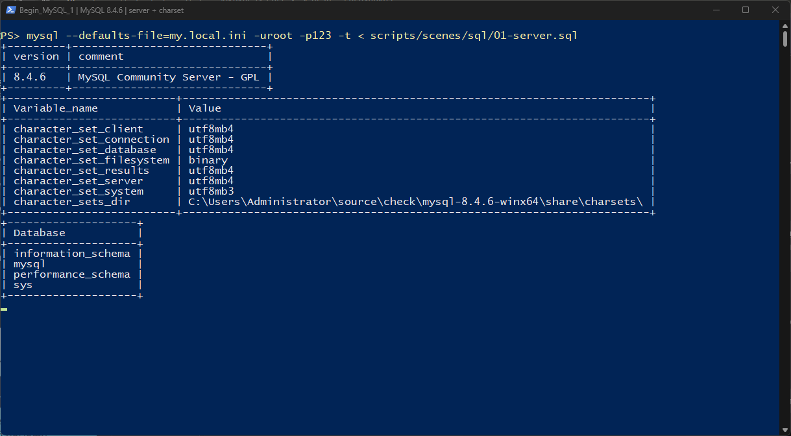
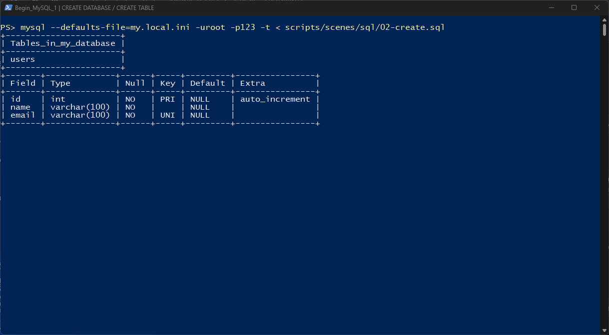
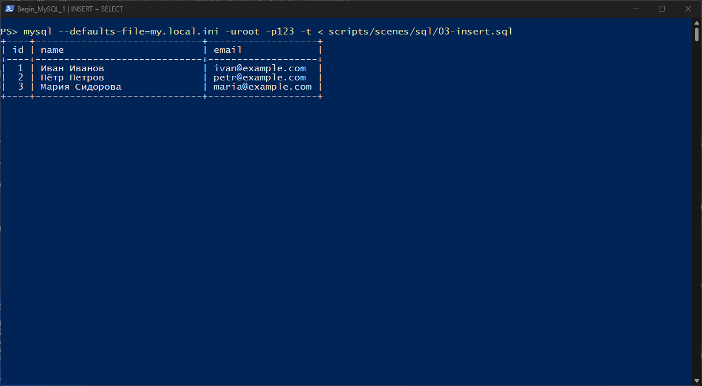
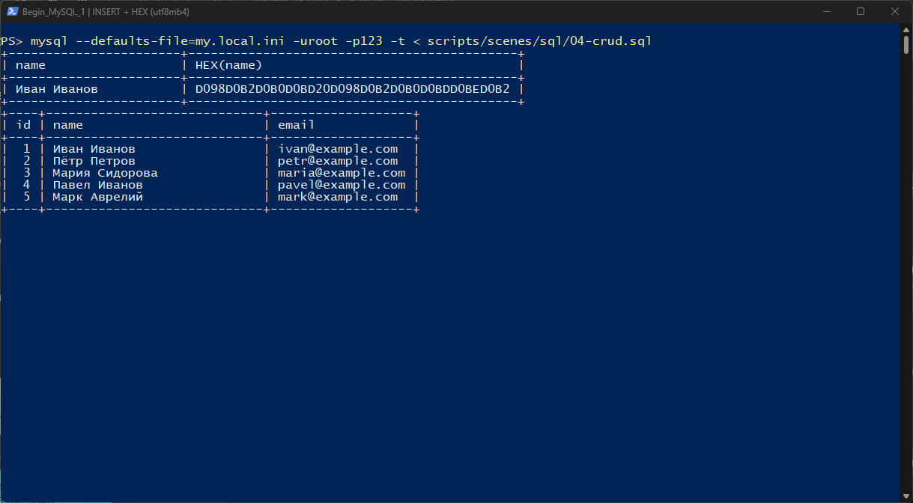
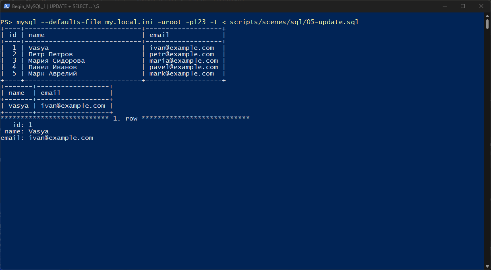
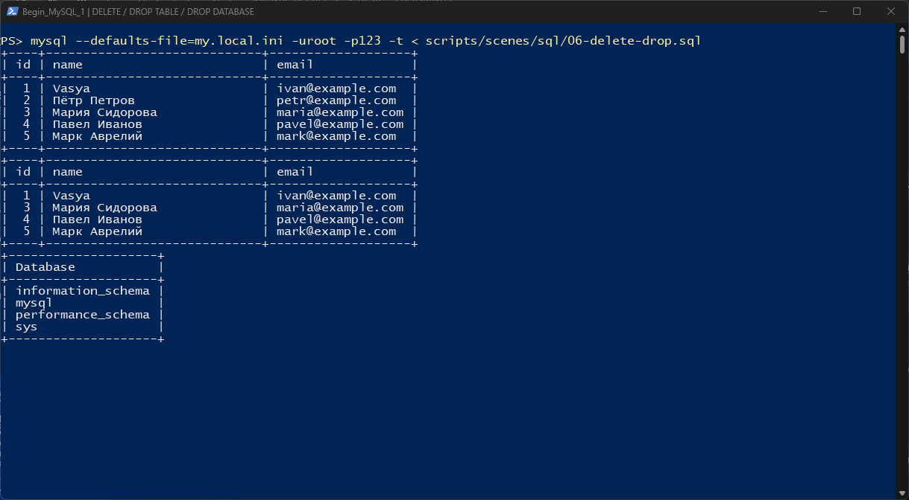
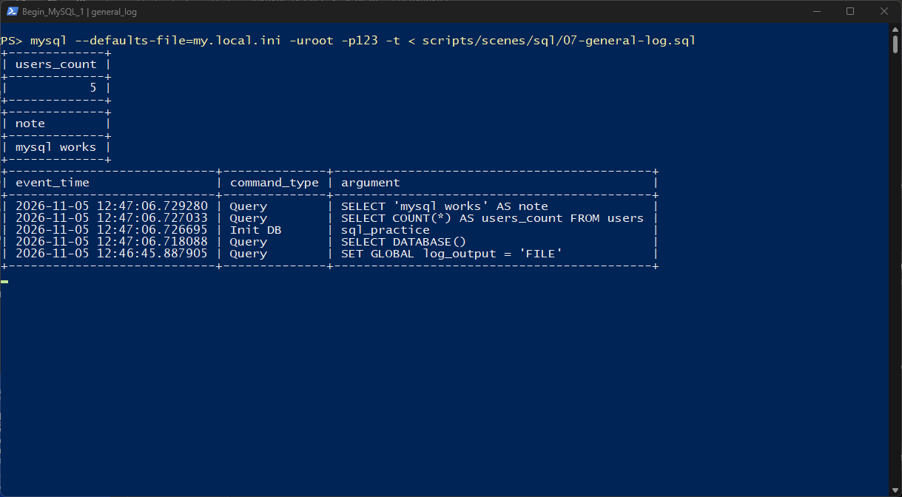
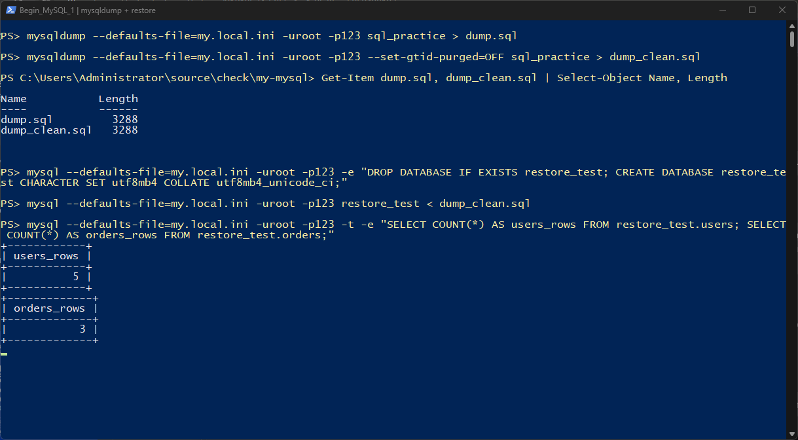

# 🎓 Отчёт по лабораторной работе: интерактивная работа с MySQL

**Выполнил:** SpleIII  
**Дата:** 05.11.2026  
**СУБД:** MySQL Community Server 8.4.6, движок InnoDB  
**Репозиторий:** [SpleIII/Begin_MySQL_1](https://github.com/SpleIII/Begin_MySQL_1)

> **Особенность окружения.** На машине, где выполнялась работа, Docker отсутствует
> (нет `docker` CLI и WSL-дистрибутивов). Поэтому вместо контейнера был запущен
> «чистый» локальный сервер MySQL 8.4.6 из официального ZIP-архива. Конфигурация
> повторяет `my.cnf` из методички: `utf8mb4`, `general_log`, InnoDB. Все команды
> `docker exec ... mysql` заменены на вызовы локального клиента с тем же результатом.

---

## 📑 Оглавление

1. [Запуск сервера и подключение](#шаг-1)
2. [Создание базы данных и таблицы](#шаг-2)
3. [Вставка данных (INSERT)](#шаг-3)
4. [Проверка кодировки utf8mb4](#шаг-4)
5. [Обновление данных (UPDATE) и вертикальный вывод](#шаг-5)
6. [Удаление данных, таблицы и базы](#шаг-6)
7. [Журнал general_log](#шаг-7)
8. [Дамп базы и восстановление](#шаг-8)
9. [Вывод](#вывод)

---

<a id="шаг-1"></a>
## 🔹 Шаг 1. Запуск сервера и подключение

Перед запуском был создан каталог `my-mysql` и файл `my.cnf` с настройками
кодировки `utf8mb4` и включённым общим журналом. Чистый каталог данных
инициализирован командой `mysqld --initialize-insecure`, после чего сервер
запущен на порту `3307`.

Подключение выполняется клиентом `mysql` от пользователя `root`:

```shell
mysql --defaults-file=my.local.ini -uroot -p123 --default-character-set=utf8mb4
```

Сразу после подключения проверены версия сервера, переменные кодировки и список
баз данных. Видно, что `character_set_client`, `character_set_connection`
и `character_set_results` равны `utf8mb4`, а в списке есть только системные БД —
сервер действительно «чистый».

📸 **Доказательство (Шаг 1):**


---

<a id="шаг-2"></a>
## 🔹 Шаг 2. Создание базы данных и таблицы

Создана база `my_database` с кодировкой `utf8mb4` и сравнением
`utf8mb4_unicode_ci`. Внутри неё создана таблица `users`:

* `id` — первичный ключ с автоинкрементом;
* `name` — имя, `VARCHAR(100)`, обязательное поле;
* `email` — почта, `VARCHAR(100)`, обязательное и уникальное поле.

Команда `SHOW TABLES` подтверждает создание таблицы, а `DESCRIBE users` показывает
её структуру: типы полей, ключи и `auto_increment`.

📸 **Доказательство (Шаг 2):**


---

<a id="шаг-3"></a>
## 🔹 Шаг 3. Вставка данных (INSERT)

В таблицу добавлены три записи с кириллическими именами. Использована
многократная форма `INSERT INTO ... VALUES (...), (...), (...)`.

Проверка через `SELECT * FROM users` показывает, что все строки записаны,
а русские имена отображаются без искажений.

📸 **Доказательство (Шаг 3):**


---

<a id="шаг-4"></a>
## 🔹 Шаг 4. Проверка кодировки utf8mb4

Добавлены ещё две записи, после чего выполнена проверка `HEX(name)` для строки
`id = 1`. Значение `D098D0B2D0B0D0BD...` — это байты UTF-8 для «Иван Иванов»:
кириллица хранится именно в `utf8mb4`, а не в однобайтовой кодировке.

`SELECT * FROM users` показывает уже пять записей.

📸 **Доказательство (Шаг 4):**


---

<a id="шаг-5"></a>
## 🔹 Шаг 5. Обновление данных (UPDATE) и вертикальный вывод

Имя записи с `id = 1` изменено дважды: сначала на «Иван Петров», затем на
«Vasya». Команда `UPDATE ... WHERE id = 1` затронула ровно одну строку — это
видно по предупреждению клиента и по итоговой таблице.

Дополнительно опробованы:

* выборка конкретных столбцов `SELECT name, email FROM users WHERE id = 1`;
* вертикальный вывод `SELECT * FROM users WHERE id = 1\G`, который удобен для
  чтения широких строк.

📸 **Доказательство (Шаг 5):**


---

<a id="шаг-6"></a>
## 🔹 Шаг 6. Удаление данных, таблицы и базы

Удалена запись `id = 2` командой `DELETE FROM users WHERE id = 2`. Сравнение
выборок до и после подтверждает, что исчезла только одна строка, а остальные
четыре остались на месте.

Затем выполнены:

* `DROP TABLE users` — таблица удалена, `SHOW TABLES` возвращает пустой список;
* `DROP DATABASE my_database` — база удалена, `SHOW DATABASES` снова показывает
  только системные БД.

📸 **Доказательство (Шаг 6):**


---

<a id="шаг-7"></a>
## 🔹 Шаг 7. Журнал general_log

В `my.cnf` включён `general_log = 1`, поэтому все команды пишутся в файл
`general.log`. При проверке выяснилось, что таблица `mysql.general_log` при
`log_output = FILE` остаётся пустой — она заполняется только если в `log_output`
добавить `TABLE`.

Для демонстрации режим был временно переключён:

```sql
SET GLOBAL log_output = 'FILE,TABLE';
```

После выполнения нескольких запросов журнал показывает время, тип команды
(`Query`, `Init DB`) и текст команды. Также проверено, что фильтр
`user_host LIKE 'root@%'` из методички в MySQL 8.4 не срабатывает: фактическое
значение имеет вид `root[root] @ localhost [::1]`, поэтому используется шаблон
`root%`. В конце режим возвращается в `FILE`.

📸 **Доказательство (Шаг 7):**


---

<a id="шаг-8"></a>
## 🔹 Шаг 8. Дамп базы и восстановление

Создана учебная база `sql_practice` с таблицами `users` и `orders`, связанными
внешним ключом. Дамп снят утилитой `mysqldump` двумя способами:

```shell
mysqldump --defaults-file=my.local.ini -uroot -p123 sql_practice > dump.sql
mysqldump --defaults-file=my.local.ini -uroot -p123 --set-gtid-purged=OFF sql_practice > dump_clean.sql
```

Оба файла получились по 3 288 байт и содержат `CREATE TABLE` и `INSERT` для всех
строк. Для проверки создана пустая база `restore_test`, в неё импортирован
`dump_clean.sql`. Контрольные запросы показывают, что восстановились все
5 пользователей и 3 заказа — дамп рабочий.

📸 **Доказательство (Шаг 8):**


---

<a id="вывод"></a>
## 📌 Вывод

В ходе работы был поднят «чистый» сервер MySQL 8.4.6 и отработаны основные
операции: создание базы и таблицы, вставка, выборка, обновление и удаление
данных, удаление таблицы и базы. Отдельно проверена кодировка `utf8mb4` —
по переменным сервера и по HEX-представлению кириллицы.

Освоены журнал `general_log` (запись в файл и таблицу, фильтрация, отключение
журналирования через `sql_log_off`) и работа с дампами: создание резервной
копии через `mysqldump` и полное восстановление базы из неё.

Все шаги воспроизводимы: SQL-сценарии лежат в [`sql/`](./sql), сценарии
скриншотов — в [`scripts/scenes/`](./scripts/scenes), фактический вывод команд —
в [`outputs/`](./outputs).

---

## 📂 Файлы работы

* [Дамп базы данных (dump.sql)](./dump.sql)
* [Дамп без GTID (dump_clean.sql)](./dump_clean.sql)
* [Журнал команд (general.log)](./general.log)
* [SQL-сценарии](./sql)
* [Вывод всех шагов в текстовом виде](./outputs)
* [Скриншоты](./screenshots)
